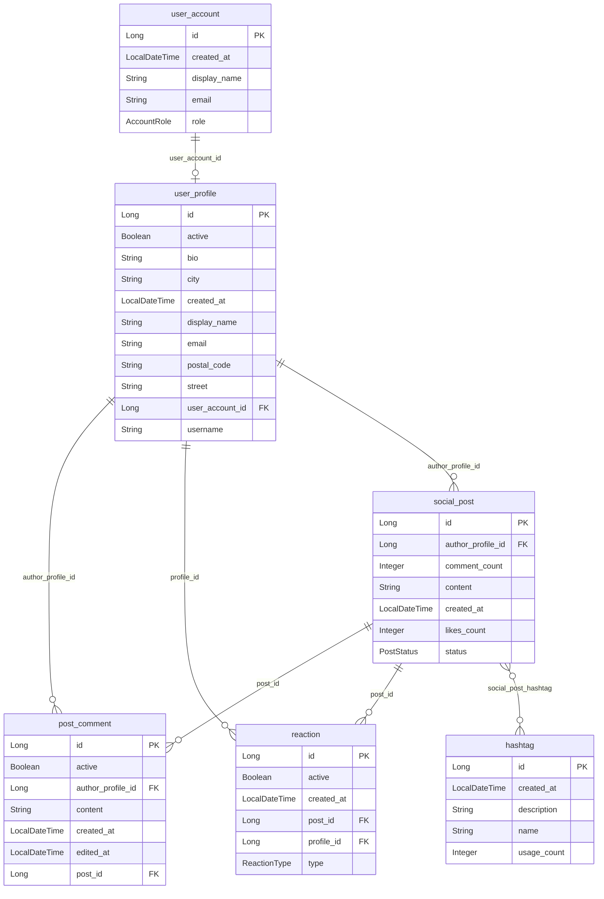

# Schemat bazy danych

Plik generują reguły projektu (panel Maven → Lifecycle → verify). Nie edytujcie go ręcznie.

Tabele: 7 (w tym tabele łączące @ManyToMany: social_post_hashtag) · kolumny: 41 · relacje: 5 × @ManyToOne, 1 × @OneToMany, 1 × @OneToOne, 2 × @ManyToMany

| Tabela | Encja | Kolumny | Klucze obce |
|---|---|---|---|
| hashtag | Hashtag | 5 | — |
| post_comment | PostComment | 7 | author_profile_id, post_id |
| reaction | Reaction | 6 | post_id, profile_id |
| social_post | SocialPost | 7 | author_profile_id |
| user_account | UserAccount | 5 | — |
| user_profile | UserProfile | 11 | user_account_id |

